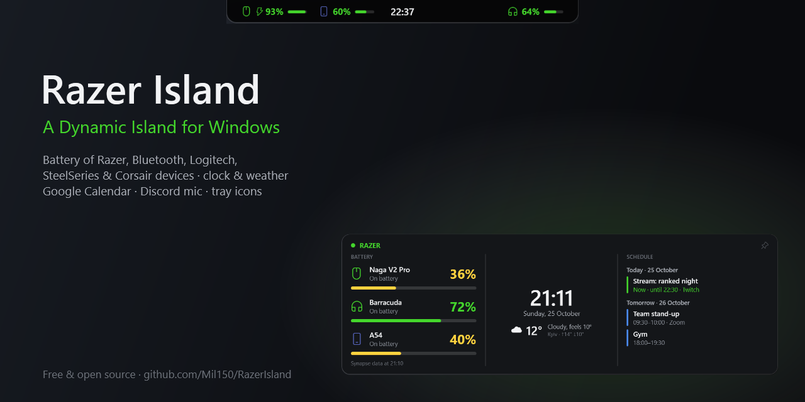
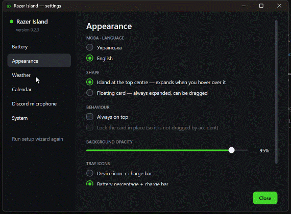

# Razer Island

[English](README.md) · **Українська**



Віджет-острівець угорі екрана (як Dynamic Island): заряд бездротових пристроїв (Razer з логів Razer Synapse 4, Bluetooth, експериментально Logitech, SteelSeries і Corsair) і в треї, годинник, погода (open-meteo.com), розклад із Google Календаря (iCal) і стан мікрофона Discord (локальний RPC).

### Як це виглядає

**Наведення** — коротке наведення виводить острівець поверх вікон, довше — розкриває його; активне вікно лишається активним.


**Мікрофон Discord** — вимкнений мікрофон видно поверх усіх вікон, червоний значок лишається, доки не ввімкнеш.


**Заряджання** — підключи кабель, і за ~2 с острівець повідомить про це, а по його гранях біжить світло.


**Налаштування** — єдиний темний стиль, українська / англійська, колір для кожного календаря.



C# / .NET 10 WPF, Windows 10 1809+ x64.

## Збирання

```powershell
dotnet build                 # розробка
.\build.ps1                  # self-contained публікація + інсталятор → artifacts\installer
.\build.ps1 -SkipInstaller   # лише artifacts\publish
```

Для інсталятора потрібен [Inno Setup 6](https://jrsoftware.org/isinfo.php) (`winget install JRSoftware.InnoSetup`).

Версія задається в `src\RazerIsland\RazerIsland.csproj` (`<Version>`), інсталятор бере її з exe. Зміни — у [CHANGELOG.md](CHANGELOG.md).

### Випуск версії

Кожен push у `master` збирає GitHub Actions ([build.yml](.github/workflows/build.yml)); інсталятор лежить в *Artifacts* запуску. Щоб випустити реліз: змінити `<Version>` у `RazerIsland.csproj`, додати розділ `## <версія>` у `CHANGELOG.md`, закомітити й запушити тег `v<версія>` — workflow збере інсталятор і створить реліз з описом із CHANGELOG.
## Структура

```
src/RazerIsland/
  App.xaml(.cs)        запуск, таймери, команди, стан мікрофона
  Core/                шляхи й версія, налаштування, журнал, автозапуск, ярлики,
                       один екземпляр, імпорт зі старої версії, WinAPI
  Battery/             читання логів Synapse 4
  Weather/             погода й пошук міста (open-meteo)
  Calendar/            iCal + RRULE, список календарів
  Discord/             RPC-клієнт: стан мікрофона
  UI/                  віджет, острівець мікрофона, трей, налаштування/майстер
installer/RazerIsland.iss
```

## Сторонні компоненти

`src/RazerIsland/Native/iCUESDK.x64_2019.dll` — Corsair iCUE SDK v4.0.84 з офіційних релізів [CorsairOfficial/cue-sdk](https://github.com/CorsairOfficial/cue-sdk) (тека `redist`, підписано Corsair Memory, Inc.). Протоколи Logitech HID++ і SteelSeries реалізовано самостійно за відкритими описами з [Solaar](https://github.com/pwr-Solaar/Solaar) і [HeadsetControl](https://github.com/Sapd/HeadsetControl); їхній код не копіювався.

## Дані

`%LOCALAPPDATA%\Razer Island\`: `settings.json`, `calendars.txt`, `error.log`. Формат `settings.json` сумісний із PowerShell-версією; під час першого запуску файли копіюються з її теки.

Для тестів змінна середовища `RAZER_ISLAND_HOME` задає окрему теку даних. Такий екземпляр не конфліктує з основним і не змінює автозапуск.

## Ліцензія

[MIT](LICENSE) © 2026 Mil150. DLL Corsair iCUE SDK поширюється на умовах Corsair.
